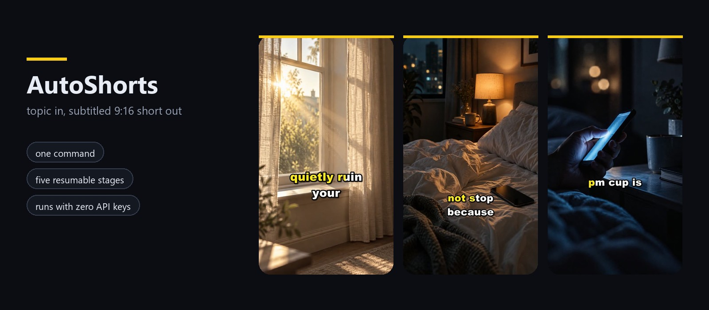
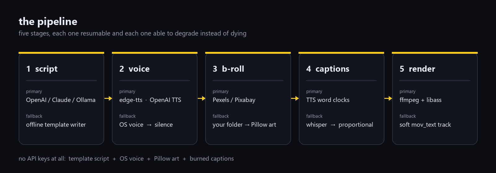
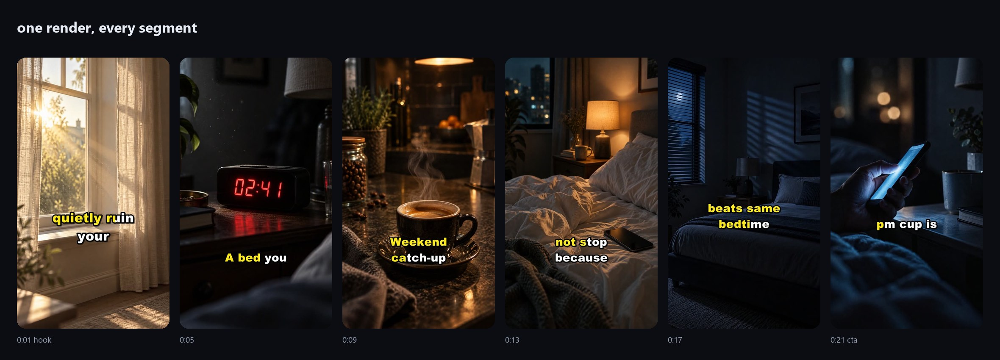

# AutoShorts

**Topic in → subtitled 9:16 short out.** An agentic pipeline that writes the
script, speaks it, picks the b-roll, burns word-by-word captions and renders the
file — from one command, on your machine.

<p align="center">
  <a href="https://ck526438-lgtm.github.io/autoshorts/"></a>
</p>

<p align="center">
  <a href="https://ck526438-lgtm.github.io/autoshorts/"><strong>Live demo page</strong></a>
  · <a href="docs/assets/demo.mp4">watch the 24-second render</a>
  · <a href="#install">install</a>
</p>

```bash
git clone https://github.com/ck526438-lgtm/autoshorts && cd autoshorts
pip install -e ".[voice,ffmpeg]"
autoshorts demo --topic "3 habits that quietly ruin your sleep"
```

That's it. No API key, no account, no Electron app, no subscription. The first
run prints the path to a ready-to-post `final.mp4`. (A `pip install autoshorts`
line is coming as soon as the name is reserved on PyPI.)

```
$ autoshorts demo --topic "why your ads lose money"
• job folder: output/20261023-184402-why-your-ads-lose-money
✓ script: 5 segments, 96 words (template)
✓ voiceover: 41.8s over 5 segments (edge)
✓ b-roll: 5 shots — procedural:5
✓ captions: 34 events, on screen 78% of the runtime
[5/5] clip 04 (8.2s)
✓ output/20261023-184402-why-your-ads-lose-money/final.mp4 — 41.8s, 5 segments, 34 caption events, 62s render
```

---

## What it actually does



| Stage | Tool | Notes |
| --- | --- | --- |
| Script | OpenAI, Anthropic, Ollama, or offline template writer | Retention-first prompt, JSON schema, hard word budget |
| Voiceover | edge-tts (free, no key), OpenAI TTS, Piper, or your OS voice | SAPI/`say`/espeak need nothing installed |
| Timings | TTS word boundaries → Whisper → proportional estimate | Captions never depend on a model you did not install |
| B-roll | Pexels, Pixabay, your own `assets/clips`, generated art | Download cache, licence trail in `metadata.json` |
| Captions | libass `\kf` karaoke | Word fills highlight colour, line pops, safe-zone placement |
| Render | one ffmpeg pass per clip + one final mix | Music bed is side-chain ducked under the voice |



Every segment gets its own visual query, so the b-roll moves with the
narration instead of looping one clip. The yellow-to-white fill is a single ASS
event with `\kf` tags, not a stack of images.

Every stage writes its artefacts into the job folder and is skipped if they
already exist. Re-cut the captions without re-paying the LLM, or resume a
folder by name alone:

```bash
autoshorts run --job output/20261023-184402-why-your-ads-lose-money --force captions --force render
autoshorts run --job output/20261023-184402-why-your-ads-lose-money
```

---

## Why this shape

- **It degrades instead of dying.** No `OPENAI_API_KEY`? The offline writer
  keeps the structure. Edge rate-limited? Fall back to your OS voice. Stock API
  empty? Generated art. A run that produces a video is worth more than a run
  that produces a stack trace.
- **Five dependencies, no SDK soup.** `httpx`, `python-dotenv`, `PyYAML`,
  `Pillow`, `edge-tts`. OpenAI and Anthropic are plain HTTPS calls, so this
  never fights the versions in your other project.
- **Local-first.** Your keys, your fonts, your footage, your output folder.
  Nothing phones home except the providers you enable.
- **The captions are the product.** Most "AI video" tools ship centered SRT
  subtitles. AutoShorts builds an ASS timeline from real word clocks: earlier
  words stay lit in the highlight colour, the current word is mid-fill, short
  bursts break on thought boundaries, and the first segment renders larger.

---

## Install

```bash
pip install -e ".[voice,ffmpeg]"     # from a clone
pip install "autoshorts[voice,ffmpeg]"   # once it is on PyPI
```

Extras:

| Extra | What it buys you |
| --- | --- |
| `[voice]` | edge-tts: free neural voices **with word timings** (recommended) |
| `[ffmpeg]` | a static ffmpeg via `imageio-ffmpeg` — the painless Windows fix |
| `[whisper]` | faster-whisper, only needed when your TTS gives no timings |
| `[piper]` | fully local neural TTS |
| `[dev]` | pytest + ruff |

`autoshorts doctor` tells you what is installed, what is missing, and which
provider will fall back:

```bash
autoshorts doctor
```

---

## Configure once, in `.env`

```bash
cp .env.example .env
```

The five you will touch:

```ini
LLM_PROVIDER=openai           # template | openai | anthropic | ollama
OPENAI_API_KEY=sk-...
TTS_PROVIDER=edge             # edge | openai | piper | system | silence
EDGE_VOICE=en-US-GuyNeural    # fr-FR-DenisNeural, es-ES-AlvaroNeural, …
STOCK_PRIORITY=pexels,pixabay,local,procedural
PEXELS_API_KEY=...            # free tier, keeps your channel on-brand
```

Nothing else is required. `TARGET_SECONDS`, `VIDEO_WIDTH/HEIGHT`,
`CAPTION_FONT`, `MUSIC_FILE` and `CLIP_LOOK` are all optional.

---

## Niches: one YAML per channel

A niche file is the brief you would hand a human editor. Edit the persona and
the whole pipeline follows it — hook style, language, word budget, voice,
visual queries, hashtags.

```yaml
name: finance
language: en
persona: a blunt operator who has actually run the numbers
tone: concrete, fast, zero motivation-speak
duration: 42
hook_styles: ["a specific number that sounds wrong"]
beats:
  - "A thirty-day invoice is a thirty-day loan to your customer."
  - "Churn is a leak. Fix the pipe before buying more water."
banned: [very, actually, in conclusion]
visual_style: "cinematic b-roll, moody lighting"
keywords: ["office desk morning light", "city timelapse night traffic"]
```

`beats:` is the bank the **offline** writer draws from when no API key is
configured — without it you get the generic productivity lines shipped in
`llm/template.py`, with it the no-key path still sounds like your channel.
`{topic}` and `{seconds}` are substituted. A human still owns the claims.

```bash
autoshorts niche init my-channel
autoshorts run --niche niches/my-channel.yaml --topic "why your ads lose money"
```

Three examples ship in [`examples/niches/`](examples/niches): finance,
French productivity, and sleep/health.

---

## Batch mode

Turn a feed into a content calendar. Any RSS/Atom source becomes one short per
headline; a failing topic is logged and skipped, never fatal to the batch.

```bash
autoshorts batch --rss https://hnrss.org/frontpage --limit 5 --duration 40
autoshorts batch --topics-file topics.txt --niche examples/niches/finance.yaml
autoshorts run --topic "cold outreach" --count 3      # 3 different angles of one idea
```

Each batch writes `output/batch-*.json` with what rendered and what did not.

## Paste your own script

The fastest path when the copy is the valuable part:

```bash
autoshorts run --script my_script.txt --topic "my title" --language fr --voice fr-FR-DenisNeural
```

## Stop before the render

Review or edit the narration and captions without spending a render cycle:

```bash
autoshorts run --topic "…" --until captions   # writes captions.ass + captions.srt, no video
```

---

## CLI

| Command | Purpose |
| --- | --- |
| `demo` | one video with zero keys and zero downloads |
| `run` | one short: `--topic`, `--script`, `--niche`, `--job`, `--force`, `--until`, `--count` |
| `batch` | one short per feed item or per line of a text file |
| `doctor` | environment, ffmpeg, optional deps, key presence, fallbacks |
| `niche init/list` | scaffold or list channel briefs |

`--dry-run` prints the resolved plan, and providers/look can be overridden per
run (`--llm --tts --voice --stock --duration --language --width --height --music --offline --prune --verbose`).

---

## What lands in the job folder

```
output/20261023-184402-why-your-ads-lose-money/
├── final.mp4          # post this
├── metadata.json      # title, description, hashtags, durations, sources
├── script.json        # segments + word clocks (edit it, then --force render)
├── captions.ass       # the karaoke styling, yours to tweak
├── captions.srt
├── plan.json          # which shot was picked for which segment
├── audio/seg_000.wav  # one take per segment
├── clips/seg_000.mp4  # one normalised clip per segment
└── work/              # concatenated base video + voice bed
```

## Design notes

- **`-14 LUFS` and no dead air.** Each take is high-passed, leading-silence
  trimmed, padded with one breath and loudness-normalised before concatenation,
  so pacing stays tight and the volume matches platform targets.
- **Ken Burns without a jittery filter.** Still shots are oversampled 2× and
  zoomed with a linear ramp in `zoompan`'s output-frame counter, which avoids
  the comma-quoting that silently breaks most copy-pasted zoom recipes.
- **Concat with a safety net.** Clips are joined by stream copy; if the
  concatenated duration drifts from the sum of its parts, the track is
  re-encoded instead of shipping an A/V desync.
- **Captions never overlap.** Group events are clipped to the next event's
  start, and word clocks are rescaled onto the measured audio length so a
  3 % shorter take cannot drift the subtitle out of sync.
- **No-libass builds still ship.** If your ffmpeg lacks `ass`, captions are
  embedded as a switchable `mov_text` track and a warning is printed.

## Limitations, honestly

- edge-tts is a free service with rate limits; heavy batch runs should use
  Piper or a paid key.
- Stock search is only as good as your `visual_query` keywords and the API's
  index; brand-specific footage belongs in `assets/clips`.
- `--offline` uses your OS voice, which sounds like it. It exists so a render
  never fails because a network did.
- No face-cam, no product shots, no multi-track music sequencing. This is a
  narration-first tool.

## Responsible use

AutoShorts makes synthetic talking-head-less video cheap, which is exactly why
it should stay honest. Read the [disclosure rules](docs/TROUBLESHOOTING.md#platform-rules)
for TikTok, YouTube and Instagram: AI-generated realistic content must be
labelled, and monetisation on Shorts/TikTok can be withheld for mass-produced
duplicate content. Do not build a spam farm with this. Do not put words about
medical, financial or political claims on screen without a human checking them —
the script stage is an optimiser, not a fact-checker.

## Contributing

See [CONTRIBUTING.md](CONTRIBUTING.md). Good first issues are tagged on the
tracker. The pipeline is deliberately small: five stages, one dataclass per
artefact, no framework.

## License

MIT — see [LICENSE](LICENSE).
